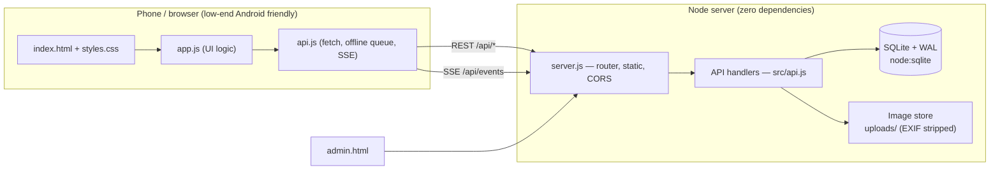
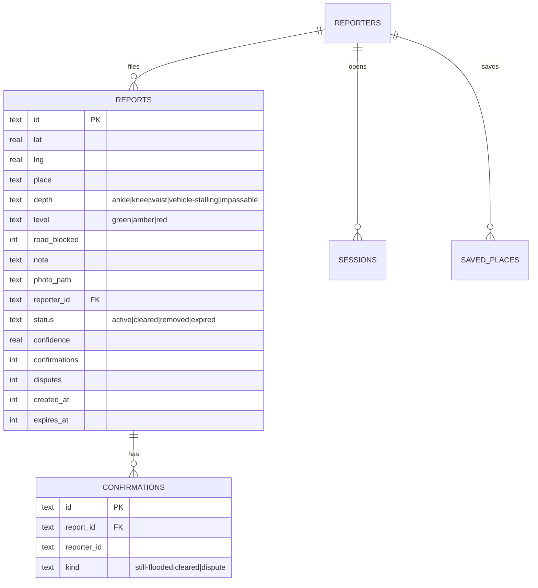

# JalRakshak — Mangaluru Community Flood Reporting (MVP)

**JalRakshak** (Kannada: ಜಲ ರಕ್ಷಕ, "Water Guardian") is a community-based flood
reporting app for **Mangaluru, Karnataka**. Residents share what they see —
water depth, road status, a photo — on a live map, and neighbours check
conditions before they travel. It fills the gap where official information is
delayed or missing (outskirts, underpasses, low-lying wards, riverside/coastal
stretches).

> ⚠️ **Safety & disclaimer.** This is **community-reported data, not an official
> warning.** The app never asks anyone to enter floodwater for a photo. In an
> emergency, follow the district administration and emergency services.

---

## 1. Quick start (local)

**Requirements:** Node.js **22.5+** (uses the built-in `node:sqlite`). No
`npm install`, no database server, no internet needed.

```bash
# from the jalrakshak/ folder
node server.js
```

Then open:

| What | URL |
|------|-----|
| Resident app (mobile-first) | http://localhost:3000 |
| Admin / moderation dashboard | http://localhost:3000/admin.html (token: `admin-dev-token`) |
| Health check | http://localhost:3000/api/health |

Open the app on your phone too: run it on a computer on the same Wi-Fi and
visit `http://<your-computer-ip>:3000`. The server binds `0.0.0.0` for this.

### Configuration (environment variables)

| Var | Default | Purpose |
|-----|---------|---------|
| `PORT` | `3000` | HTTP port |
| `HOST` | `0.0.0.0` | Bind address (LAN access for phones) |
| `DB_PATH` | `data/jalrakshak.db` | SQLite file, or `:memory:` for tests |
| `ADMIN_TOKEN` | `admin-dev-token` | Secret for admin API/dashboard |
| `REPORT_TTL_HOURS` | `6` | How long a report stays "live" before expiry |
| `NEARBY_RADIUS_M` | `300` | Cluster radius for confidence + dedupe |
| `ROUTE_BUFFER_M` | `150` | Corridor half-width for route checks |

Example: `PORT=8080 ADMIN_TOKEN=s3cret node server.js`

---

## 2. Testing

```bash
npm test         # 33 unit + integration + E2E tests (node:test)
npm run loadtest # spike test: 500 reqs / 50 concurrent → see load-report.txt
```

Latest run: **33/33 passing**; load test **353 req/s, 0 errors, p95 ≈ 236 ms**.

---

## 3. What's implemented (MVP scope)

| Feature | Status | Where |
|---------|--------|-------|
| Quick report (photo, GPS, depth, note, road-blocked) | ✅ | `public/app.js`, `src/api.js` |
| Safety-first prompt before capture | ✅ | `index.html` modal step 1 |
| Live community map with colour-coded severity | ✅ | map pins from real `mapX/mapY` |
| Report age + auto-expiry (fade after TTL) | ✅ | `src/confidence.js`, expiry sweep |
| Community verification (still-flooded / cleared / dispute) | ✅ | confirm endpoint |
| Route / destination flood check (corridor buffer) | ✅ | `/api/route-check` |
| Saved places with live flood status | ✅ | `/api/places` |
| Offline queue + auto-retry | ✅ | `public/api.js` |
| Anonymous + phone-OTP login | ✅ (OTP is a **dev simulation**) | `src/api.js` |
| Confidence scoring per report | ✅ | `src/confidence.js` |
| Moderation queue + admin dashboard | ✅ | `public/admin.html` |
| EXIF/GPS stripping on uploads | ✅ | `src/images.js` |
| Rate limiting | ✅ | `src/http.js` |
| Realtime updates (SSE) | ✅ | `/api/events` |
| Seed hotspots (real Mangaluru locations) | ✅ | `src/seed-hotspots.js` |

---

## 4. Architecture



### Why this stack (Decisions Log)

- **Node built-ins only (`node:http` + `node:sqlite`).** The brief demands
  near-zero budget, offline-first behaviour, and local hosting. Node 22+ ships
  SQLite, so the whole backend runs with **`node server.js` and nothing else** —
  no `npm install`, no Postgres/Redis, ideal for a workshop MVP and for running
  on a cheap VPS later.
- **SQLite + in-app haversine** instead of PostGIS for the MVP. City-scale data
  (hundreds of reports) makes a bbox pre-filter + precise JS distance plenty
  fast (see load test). Migration path to PostGIS is noted below.
- **Server-Sent Events** instead of WebSockets: one-way live updates are all the
  map needs, and SSE auto-reconnects over flaky mobile networks.
- **JSON + base64 photos** instead of multipart uploads: simpler, works behind
  the offline queue, and images are compressed on-device before send.

### Data model (ERD)



### Geospatial strategy

- **Projection for the map:** real `lat/lng` → `mapX/mapY` in `[0,1]` over the
  city bounding box (`projectToMap` in `src/util.js`). The stylised SVG map in
  the front-end places each pin with `left: mapX*100%`, `top: mapY*100%`, so
  pins line up with their real neighbourhoods.
- **"Floods near my route":** for a straight A→B segment we compute the
  point-to-segment distance (`distanceToSegmentMeters`) and flag any active
  report within `ROUTE_BUFFER_M` (150 m). V2 will use a real routed polyline
  (OSRM/GraphHopper) and buffer that geometry instead.
- **Confidence & dedupe:** independent reports within `NEARBY_RADIUS_M` (300 m)
  corroborate each other and raise the confidence score.

### Confidence scoring (trust, not truth)

`computeConfidence` blends: reporter reputation, independent "still flooded"
confirmations (+), disputes/cleared (−), photo sanity (+), nearby corroboration
(+), and recency decay. It is a **triage aid** — the UI always shows the
community disclaimer. Severity (`green/amber/red`) is derived from water depth,
and can be softened one step by heavy community dispute.

---

## 5. API reference (summary)

| Method | Path | Auth | Purpose |
|--------|------|------|---------|
| GET | `/api/health` | – | Liveness |
| GET | `/api/config` | – | City bbox + disclaimer |
| POST | `/api/session` | – | Create anonymous session → token |
| POST | `/api/auth/otp` | – | Request phone OTP (dev code returned) |
| POST | `/api/auth/verify` | – | Verify OTP → token |
| GET | `/api/me` | token | Current reporter |
| GET | `/api/reports?minLat=&maxLat=&minLng=&maxLng=` | – | List active reports (optional bbox) |
| POST | `/api/reports` | token | Create a report |
| GET | `/api/reports/:id` | – | Report detail + confirmation counts |
| POST | `/api/reports/:id/confirm` | token | `{kind:"still-flooded"\|"cleared"\|"dispute"}` |
| POST | `/api/route-check` | – | `{from:{lat,lng}, to:{lat,lng}}` |
| GET/POST/DELETE | `/api/places[/:id]` | token | Saved places |
| GET | `/api/hotspots` | – | Seed reference hotspots |
| GET | `/api/events` | – | SSE live stream |
| GET | `/api/admin/queue` | admin | Moderation queue |
| POST | `/api/admin/moderate/:id` | admin | `{action:"approve"\|"remove"\|"expire"}` |
| GET | `/api/admin/stats` | admin | Analytics |

Example create:
```bash
curl -X POST localhost:3000/api/session            # copy token
curl -X POST localhost:3000/api/reports \
  -H 'Authorization: Bearer <token>' -H 'Content-Type: application/json' \
  -d '{"lat":12.9505,"lng":74.8840,"place":"Kottara Chowki","depth":"vehicle-stalling","roadBlocked":true}'
```


---

## 6. Security & privacy (DPDP Act 2023 alignment)

- **Minimal data.** Anonymous sessions need no phone. Phone numbers are stored
  only as a **SHA-256 hash** (never plaintext) when a user upgrades to OTP login.
- **No exact home addresses.** Location is a user-controlled pin that may be
  coarse. We never derive or store a home address.
- **EXIF/GPS stripped** from every uploaded photo (`src/images.js` drops JPEG
  APPn/EXIF and PNG metadata chunks). Location comes only from the pin.
- **Upload hardening.** Magic-byte type checks, size cap (4 MB), and on-device
  compression before send.
- **Rate limiting** on reports, confirmations, and auth (sliding window).
- **Threat model (MVP):** fake/spam reports are mitigated by confidence scoring,
  duplicate clustering, rate limits, disputes, and the admin review queue. This
  is not a substitute for moderation during a real event.

---

## 7. Seed data — real Mangaluru hotspots

18 documented flood/waterlogging locations are seeded (`src/seed-hotspots.js`)
with cause tags and sources. **Coordinates are approximate (block-level) and
must be verified against ward maps before any public launch.**

Sources:
- The Hindu, *"30 areas prone to floods"* (2016) — names city hotspots incl.
  Kottara Chowki, Pandeshwar, Hoige Bazaar, Kasba Bengre, Jeppinamogaru, Bokkapatna.
- Daijiworld (May 2025) — Malemar–Kottara Chowki, Pumpwell, Jyothi Circle,
  Car Street, Bajal & Padil underpass waterlogging.
- The Times of India (2018) — Pumpwell & Padil underpass flooding.

| Hotspot | Primary cause |
|---------|---------------|
| Kottara Chowki / Malemar | low-lying land |
| Pumpwell, Jyothi Circle | drainage |
| Padil & Bajal underpasses | underpass design |
| Hoige Bazaar, Kasba Bengre, Port Road | tides/backflow |
| Bokkapatna, Kulur bridge | river/swell |

---

## 7b. Hosting on Cloudflare

Two options, depending on whether you have a Cloudflare account and want a
permanent deployment.

### Option A — Quick Tunnel (no account, live in ~30 seconds) ✅ *currently running*

Publishes the local server through Cloudflare's edge to a temporary public URL.
App code is **unchanged**. Uses the bundled helper:

```powershell
.\cloudflare-host.ps1 -Action start     # boots app + tunnel, prints the URL
.\cloudflare-host.ps1 -Action url       # show the current public URL
.\cloudflare-host.ps1 -Action status    # is the app/tunnel up?
.\cloudflare-host.ps1 -Action stop      # stop both
```

- Requires `cloudflared.exe` in the project folder (the script auto-downloads it).
- Your PC must stay on; the `*.trycloudflare.com` URL changes on each restart.
- No uptime guarantee — for experiments, demos, and pilot testing only.

### Option B — Named Tunnel or Workers (permanent, needs your Cloudflare account)

I **cannot log into your Cloudflare account** from here — that needs an
interactive browser login only you can do. Once you're ready, the paths are:

### Option B — Named Tunnel (permanent, stable URL + your domain)

A named tunnel gives a **stable hostname on your own domain**, backed by your
Cloudflare account (real uptime guarantee). Your PC still runs `node server.js`;
Cloudflare fronts it with automatic HTTPS.

**Prerequisite:** your domain's DNS must be managed by Cloudflare (add the
domain in the Cloudflare dashboard first). If you don't have a domain, use the
Quick Tunnel above.

**One command does login → create → DNS → config → run:**

```powershell
.\cloudflare-named-tunnel.ps1 -Hostname floods.yourdomain.com
```

- **Step 1 opens your browser** to authorize Cloudflare — that's the only part
  you must do yourself (I can't click through OAuth). Pick your zone, Authorize.
- The script then creates the tunnel, routes DNS, writes `config.yml`, and runs.
- After first setup, to run again later: the script detects existing credentials
  and skips straight to starting the tunnel.

Manual equivalent (if you prefer to run each step):
```powershell
.\cloudflared.exe tunnel login                         # browser auth
.\cloudflared.exe tunnel create jalrakshak             # note the UUID
.\cloudflared.exe tunnel route dns jalrakshak floods.yourdomain.com
# config.yml is pre-written by the script; then:
.\cloudflared.exe --config .\config.yml tunnel run jalrakshak
```

Files created for you: `config.yml` (template) and
`cloudflare-named-tunnel.ps1` (automated setup).

**B2. Cloudflare Workers + D1 + R2 (fully serverless, no PC needed):**
This requires adapting the backend to Cloudflare's runtime (no filesystem, no
`node:sqlite`, no long-lived process):

| Concern | Local MVP | Cloudflare equivalent |
|---------|-----------|-----------------------|
| HTTP server | `node:http` | Worker `fetch` handler |
| Database | SQLite file | **D1** (Cloudflare's SQLite) |
| Image uploads | local `uploads/` | **R2** object storage |
| Rate limiting / SSE | in-memory | **Durable Objects** |
| Routing/static | `server.js` | **Pages/Workers Static Assets** |

The clean migration is to port `src/db.js` (SQL → D1 bindings) and
`src/images.js` (disk → R2), keep `src/api.js` logic intact, and deploy with
`wrangler`. Happy to build that adapter next if you want to go serverless.

---

## 8. Migration to production (when you outgrow local)

| Concern | MVP (now) | Production path |
|---------|-----------|-----------------|
| Database | SQLite + haversine | PostgreSQL + **PostGIS** (`ST_DWithin`, `ST_Buffer`) |
| Geo "near route" | straight segment + buffer | real polyline via **OSRM/GraphHopper** |
| Images | local `uploads/` | S3-compatible store + CDN |
| Realtime | SSE (single node) | SSE behind a load balancer, or Redis pub/sub |
| Rate limit | in-memory | Redis |
| OTP | dev simulation | real SMS gateway (MSG91/Twilio) |
| Push/SMS alerts | — | FCM + SMS for saved places/routes |
| Hosting | `node server.js` | autoscaling VM/container; static front-end on CDN |

The data-access layer (`src/db.js`) and API handlers (`src/api.js`) are the only
places that touch storage, so swapping SQLite for PostGIS is contained.

---

## 9. Pre-monsoon & monsoon-day operations checklist

**Before monsoon (by early June):**
- [ ] Verify all seed hotspot coordinates against MCC ward maps.
- [ ] Replace the OTP simulation with a real SMS provider.
- [ ] Set a strong `ADMIN_TOKEN`; restrict admin network access.
- [ ] Partner with 2–3 Resident Welfare Associations + a college for pilot wards.
- [ ] Brief moderators; agree an escalation path to the district administration.
- [ ] Publish privacy policy + terms; confirm DPDP compliance with counsel.
- [ ] Load-test at 2× expected peak; confirm autoscaling/backups if hosted.
- [ ] Localise UI strings (Kannada first, then Tulu/Konkani).

**Monsoon day (during heavy rain):**
- [ ] Watch the admin queue; clear false/disputed reports quickly.
- [ ] Monitor `/api/admin/stats` for spikes; confirm p95 latency stays low.
- [ ] Keep the disclaimer visible; re-share official warnings when issued.
- [ ] Log any life-threatening report and escalate to authorities immediately.

---

## 10. Decisions Log

1. **Zero-dependency Node backend** (built-in `node:sqlite`) — budget + local hosting.
2. **Keep the existing front-end UI**; rewire data layer only — preserves the polished design.
3. **SQLite + haversine** over PostGIS for MVP — simplicity; documented migration path.
4. **SSE** over WebSockets — one-way live map, auto-reconnect on bad networks.
5. **Confidence as triage, not truth** — always show the community disclaimer.
6. **Severity from water depth**, softened only by strong community dispute.
7. **Base64 photos** with on-device compression — fits the offline queue.
8. **Anonymous-first auth**, phone OTP optional — lowers the barrier to report.

## 11. Open Questions (need your input / verification)

- [ ] Exact coordinates for each seed hotspot (block-level → verify with MCC).
- [ ] Real SMS provider + budget for OTP and alerts.
- [ ] Legal review: DPDP Act 2023 obligations, liability wording for disclaimers.
- [ ] Data-sharing MoU with Mangaluru City Corporation / district administration.
- [ ] Ward boundaries file to enable ward-level reports and alerts (V2).
- [ ] Official APIs for rainfall/river levels (IMD, CWC gauges) for overlays (V2).
- [ ] App name finalisation and localisation budget (Kannada/Tulu/Konkani).

